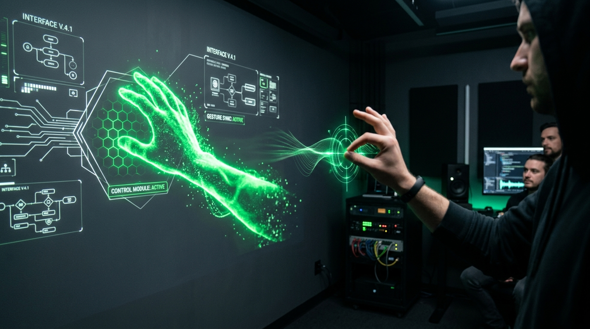

# Touchless Projection Mapping 🖐️✨

> Sistema definitivo de proyección interactiva holográfica potenciado por visión artificial acelerada por hardware (CUDA), suite de 8 modelos de segmentación neuronal y automatización IoT física en tiempo real.

<p align="center">
  
</p>

---

## 🌟 Descripción General

**Touchless Projection Mapping** transforma cualquier pared u objeto físico en una superficie interactiva de control sin necesidad de sensores vestibles, pantallas táctiles ni costosas cámaras de profundidad.

A través de una cámara web estándar y una GPU con aceleración CUDA, el sistema rastrea las manos con **MediaPipe**, segmenta los brazos utilizando modelos fundacionales de vanguardia (**FastSAM**, **YOLO11-seg**, **Robust Video Matting** o algoritmos diferenciales), proyecta una silueta holográfica verde neón sobre fondos de video dinámicos con fusión aditiva (`mix-blend-mode: screen`), y activa dispositivos físicos reales (enchufes inteligentes Kasa, luces, actuadores) mediante **WebSockets**.

---

## 🏛️ Arquitectura del Proyecto (`src-layout`)

```text
touchless-projection-mapping/
├── config/                      ← CONFIGURACIÓN CENTRALIZADA Y ESCENAS
│   ├── devices.yaml             (Mapeo de dispositivos IoT físicos)
│   ├── devices.dev.yaml         (Modo desarrollo / simulación segura mock)
│   ├── objects.json             (Polígonos y figuras interactivas proyectadas)
│   └── examples/                (Escenas de ejemplo: lámpara, estantería)
│
├── src/                         ← CÓDIGO FUENTE UNIFICADO (src-layout estándar)
│   ├── backend/                 (FastAPI, WebSockets, control IoT y editor interactivo)
│   │   ├── devices/             (Controladores: wifi_switch, kasa, http, udp, mock)
│   │   ├── static/              (Editor visual de polígonos y estilos en navegador)
│   │   ├── config.py & server.py (Núcleo del runtime del servidor)
│   │   └── editor.py            (Lógica del editor de geometrías interactivas)
│   │
│   └── vision/                  (Motor neuronal acelerado por GPU / CUDA)
│       ├── engine.py            (Bucle de visión, shaders GPU y telemetría)
│       ├── server.py            (Servidor HTTP, streaming MJPEG y API REST)
│       ├── hand_tracker.py      (MediaPipe Hand Landmarker + Filtro One-Euro)
│       ├── gpu_renderer.py      (Shader holográfico BGR cuDNN acelerado en GPU)
│       ├── models/              (Pesos locales: FastSAM-s, YOLO11, Hand Landmarker)
│       └── pipelines/           (Pipelines para RVM, YOLO11-seg, FastSAM, Resta GPU)
│
├── frontend/                    ← INTERFACES DE USUARIO Y PROYECCIÓN
│   ├── controller.html          (Panel del operador: visor de cámara, modelos, controles)
│   └── projector.html           (Ventana de proyección en pared: negro puro, cero HUD)
│
├── tests/                       ← BANCO DE PRUEBAS AUTOMATIZADO (580 tests)
│   ├── backend/                 (Pruebas de servidor, dispositivos, editor y WebSocket)
│   └── vision/                  (Pruebas de modelos IA, shaders GPU, tracking y matting)
│
├── scripts/                     ← HERRAMIENTAS Y SCRIPTS OPERATIVOS
│   ├── benchmark.py             (Medición aislada de latencia y FPS reales)
│   ├── download_models.py       (Descarga y verificación de pesos neuronales)
│   ├── generate_synthetic_clips.py (Generador de secuencias de video sintéticas)
│   ├── record_clips.py          (Grabador interactivo de clips de prueba)
│   └── list_displays.py         (Enumerador multiplataforma de proyectores y pantallas)
│
├── docs/                        ← DOCUMENTACIÓN TÉCNICA Y ARQUITECTURA
│   ├── assets/                  (Imágenes y diagramas de arquitectura)
│   ├── ARCHITECTURE.md          (Especificación técnica del sistema)
│   ├── AUDIT.md & CHANGELOG.md  (Auditorías y registro de cambios)
│   └── SETUP_GUIDE.md           (Guía paso a paso de puesta en marcha)
│
├── docker/                      ← DESPLIEGUE CONTENERIZADO (Dockerfile y Compose)
├── iniciar_proyecto.bat         ← ARRANQUE CON 1 CLIC (Windows: Backend + Visión)
├── setup.bat                    ← INSTALADOR AUTOMÁTICO DE ENTORNO Y CUDA
├── pyproject.toml               ← Configuración unificada de paquetes y pytest
├── requirements.txt             ← Dependencias consolidadas del sistema
└── README.md
```

---

## 🎯 Suite de 8 Modelos de Segmentación

El sistema permite alternar en caliente entre 8 métodos de segmentación para garantizar la máxima fluidez según el hardware disponible:

| # | Modelo | Dispositivo | FPS | Latencia | Características Principales |
| :-: | :--- | :---: | :---: | :---: | :--- |
| **1** | **FastSAM Point-Prompt** | CUDA (FP16) | **33 FPS** | ~30 ms | **Modo Recomendado.** Extracción orgánica por punto anatómico, contornos finos sin cajas. |
| **2** | **YOLO11-seg** | CUDA (FP16) | **37 FPS** | ~27 ms | Máxima velocidad pura con `retina_masks=True` y filtrado por instancia de mano. |
| **3** | **RVM MobileNetV3** | CUDA | **34 FPS** | ~29 ms | Video matting temporal recurrente con memoria de bordes y preservación interdigital. |
| **4** | **RVM ResNet50** | CUDA | **28 FPS** | ~35 ms | Máxima fidelidad en siluetas anatómicas y dedos finos. |
| **5** | **Resta de Fondo GPU** | GPU / CPU | **34 FPS** | ~29 ms | Resta diferencial contra pared física calibrada con tecla `[Espacio]`. Cero parpadeo. |
| **6** | **Resta de Fondo Web** | Navegador | **40 FPS** | ~25 ms | Fallback 100% en navegador con semillas anatómicas de MediaPipe. |
| **7** | **MediaPipe Pose Web** | Navegador | **28 FPS** | ~35 ms | Fallback web independiente basado en pose anatómica (v3). |
| **8** | **RVM ONNX Web** | Navegador | **22 FPS** | ~45 ms | Fallback web basado en ONNX Runtime WebAssembly (v4). |

---

## 🚀 Instalación y Puesta en Marcha

### Requisitos de Hardware
- **Sistema Operativo:** Windows 10/11 (64-bit)
- **Python:** Python 3.10, 3.11, 3.12 o 3.13 (64-bit)
- **GPU (Recomendada):** NVIDIA GeForce (GTX 1650 Ti+, RTX 2060+, RTX 30/40 series o Quadro) con soporte CUDA. Si no dispone de GPU NVIDIA, arrancará en modo seguro por CPU.
- **Periféricos:** Cámara web USB conectada y proyector HDMI (o pantalla secundaria).

---

### Método 1: Instalación Automática (Recomendado en Windows)

1. **Configurar el entorno (Solo la primera vez):**
   Haz doble clic en:
   ```text
   setup.bat
   ```
   *Crea el entorno virtual `.venv`, instala PyTorch con aceleración CUDA, descarga las dependencias y verifica la GPU.*

2. **Iniciar el Sistema:**
   Haz doble clic en:
   ```text
   iniciar_proyecto.bat
   ```

---

### Método 2: Inicio Manual por Consola

```bash
# 1. Crear entorno virtual e instalar dependencias
python -m venv .venv
.venv\Scripts\activate
pip install -r requirements.txt

# 2. Descargar pesos de los modelos (si es necesario)
python scripts/download_models.py

# 3. Iniciar el backend de control IoT (puerto 8000)
python -m backend --devices config/devices.dev.yaml --objects config/objects.json

# 4. Iniciar el motor de visión y servidor web (puerto 5051)
python -m vision
```

*(Opcional) Si deseas controlar hardware vía Docker:*
```bash
docker compose up -d
```

---

## 🖥️ Sistema de 2 Pantallas (Dual-Window)

Una vez iniciado el servidor, abre tu navegador web:

1. **Pantalla 1 — Laptop del Operador:**
   - URL: **`http://localhost:5051/controller.html`**
   - Vista en vivo de cámara, selector dinámico de los 8 modelos, telemetría de GPU, controles de video de fondo y calibración.

2. **Pantalla 2 — Proyector en Pared:**
   - URL: **`http://localhost:5051/projector.html`**
   - Arrastra esta pestaña a la pantalla extendida del proyector y presiona **F11** (o tecla **F**) para pantalla completa.
   - **Regla óptica estricta:** Muestra exclusivamente el brazo holográfico verde neón y el video de fondo si está cargado. Cero menús, cero botones y fondo negro puro `#000000` para proyección transparente sobre la pared física.

---

## 🎮 Controles Rápidos y Atajos de Teclado

| Tecla | Acción |
| :---: | :--- |
| **`[Espacio]`** o **`[C]`** | **Calibrar fondo:** Captura la pared vacía como referencia limpia. |
| **`[B]`** | **Alternar modelo:** Conmuta secuencialmente entre los 8 modelos de segmentación. |
| **`[G]`** | **Fast Guided Filter:** Activa/desactiva el filtrado de bordes finos en GPU. |
| **`[V]`** | **Video de fondo:** Pausa o reanuda el video de fondo proyectado. |
| **`[F]`** o **`[F11]`** | **Pantalla completa:** En la ventana de proyección. |
| **`[P]`** | **Abrir proyector:** Abre la ventana secundaria de proyección. |
| **`[Q]`** o **`[ESC]`** | **Detener:** Cierra el motor de visión y libera la memoria VRAM. |

---

## 🎬 Video de Fondo Dinámico para Mapeo

El sistema incluye integración nativa de video de fondo para enriquecer visualmente el mapping:
- **Carga de Video:** Selecciona cualquier archivo `.mp4`, `.webm` u `.ogg` desde el controlador.
- **Fusión Óptica `mix-blend-mode: screen`:** Los píxeles negros del brazo digital son 100% transparentes, proyectando el holograma nítido sobre el video en reproducción continua.
- **Control de Brillo en Vivo:** Ajusta el deslizador de brillo (10% - 100%) para balancear el contraste con la iluminación ambiental de la sala.

---

## 🧪 Pruebas Unitarias y Benchmarking

```bash
# Ejecutar suite completa de pruebas unitarias
pytest tests/ -v

# Ejecutar benchmark de rendimiento por etapas en GPU
python scripts/benchmark.py --mode all --frames 60
```

---

## 🤝 Créditos y Reconocimientos

- Módulos de automatización de hardware y hub WebSocket en `backend/` basados en [interactive-projection-mapping](https://github.com/buildwbrendan/interactive-projection-mapping) de **Brendan**.
- Motor de visión unificado (`vision_engine/`), suite multimodelo (FastSAM, YOLO11, RVM), sincronización de doble ventana, fusión de video de fondo y shaders holográficos desarrollados por **Jhan Hernández**.

---

## 📄 Licencia

Este proyecto está distribuido bajo la Licencia MIT. Consulta el archivo [LICENSE](LICENSE) para más información.
