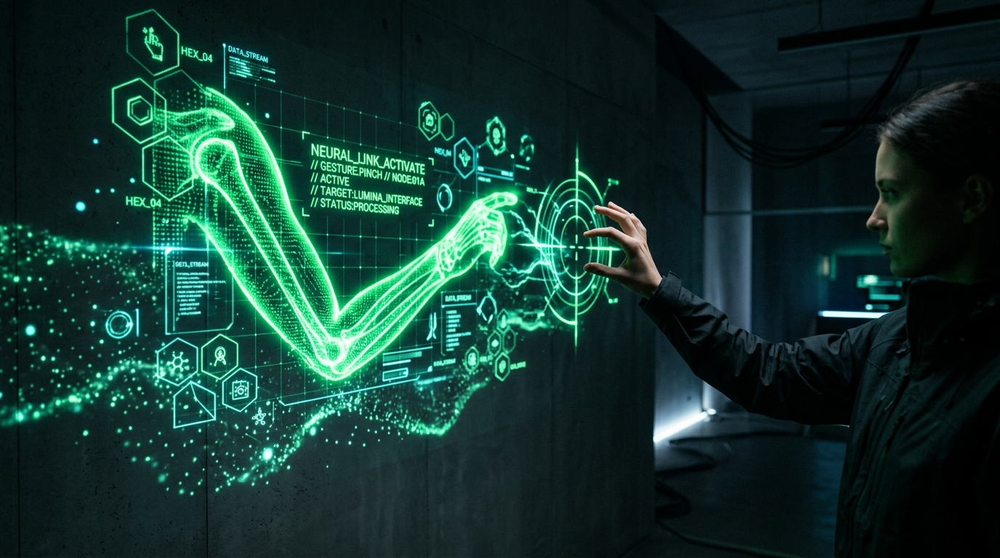

# Touchless Projection Mapping 🖐️✨

> Sistema definitivo de proyección interactiva holográfica potenciado por visión artificial acelerada por hardware (CUDA), suite de 8 modelos de segmentación neuronal y automatización IoT física en tiempo real.

<p align="center">
  
</p>

---

## 🌟 Descripción General

**Touchless Projection Mapping** transforma cualquier pared u objeto físico en una superficie interactiva de control sin necesidad de sensores vestibles, pantallas táctiles ni costosas cámaras de profundidad.

A través de una cámara web estándar y una GPU con aceleración CUDA, el sistema rastrea las manos con **MediaPipe**, segmenta los brazos utilizando modelos fundacionales de vanguardia (**FastSAM**, **YOLO11-seg**, **Robust Video Matting** o algoritmos diferenciales), proyecta una silueta holográfica verde neón sobre fondos de video dinámicos con fusión aditiva (`mix-blend-mode: screen`), y activa dispositivos físicos reales (enchufes inteligentes Kasa, luces, actuadores) mediante **WebSockets**.

---

## 🏛️ Arquitectura del Proyecto

```text
touchless-projection-mapping/
├── vision_engine/                   ← MOTOR CENTRAL DE VISIÓN ARTIFICIAL (Python/CUDA)
│   ├── engine.py                    (Bucle de visión, aislamiento orgánico y shaders GPU)
│   ├── server.py                    (Servidor HTTP, streaming MJPEG, SSE y API REST)
│   ├── config.py                    (Configuración centralizada y rutas relativas)
│   ├── hand_tracker.py              (MediaPipe Hand Landmarker + Filtro One-Euro + Histéresis)
│   ├── gpu_renderer.py              (Shader holográfico BGR cuDNN acelerado en GPU)
│   ├── arm_selector.py              (Filtro anatómico estricto de extremidades)
│   ├── models/                      (Pesos locales: FastSAM-s.pt, yolo11n-seg.pt, hand_landmarker.task)
│   └── pipelines/
│       ├── yolo_pipeline.py         (Pipelines para YOLO11-seg y FastSAM Point-Prompt)
│       └── rvm_background.py        (Pipelines para Robust Video Matting y Resta de Fondo)
│
├── frontend/                        ← INTERFACES DE USUARIO Y PROYECCIÓN
│   ├── controller.html (index.html) (Panel táctico del operador: telemetría, 8 modelos, video)
│   ├── projector.html (projection.html) (Ventana de pared: fondo negro puro/video, cero HUD)
│   ├── server.py                    (Servidor HTTP local con integración a Vision Engine)
│   ├── objects.json                 (Polígonos y figuras interactivas mapeadas en pared)
│   ├── v3/                          (Prototipo histórico: MediaPipe Pose en navegador)
│   └── v4/                          (Prototipo histórico: RVM ONNX en navegador)
│
├── backend/                         ← HUB DE HARDWARE E IOT (FastAPI / Docker)
│   ├── src/                         (Servidor WebSocket hub y controladores de dispositivos)
│   ├── data/                        (Configuración de dispositivos devices.yaml / mock)
│   ├── docker/ & docker-compose.yml (Despliegue contenerizado en puerto 8080)
│   └── README.md                    (Documentación de integración de hardware)
│
├── tests/                           ← BANCO DE PRUEBAS AUTOMATIZADO
│   ├── test_baseline.py             (Pruebas de importación, VideoFileSource y endpoints HTTP)
│   ├── test_arm_selector.py         (Validación de aislamiento anatómico de brazos)
│   ├── test_gpu_renderer.py         (Validación de shaders y Guided Filter)
│   ├── test_hand_tracker.py         (Validación de OneEuroFilter y HysteresisPinchDetector)
│   ├── test_rvm_background.py       (Validación de RVM y Resta de Fondo)
│   └── test_yolo_pipeline.py        (Validación de YOLO11-seg y FastSAM)
│
├── tools/                           ← HERRAMIENTAS Y BENCHMARKING
│   ├── benchmark.py                 (Medición aislada de latencia por etapas y FPS reales)
│   ├── download_models.py           (Descarga automatizada y verificación de pesos neuronales)
│   ├── generate_synthetic_clips.py  (Generador de secuencias de video de prueba sintéticas)
│   └── record_clips.py              (Grabador interactivo de clips de prueba con cámara)
│
├── iniciar_proyecto.bat             ← ARRANQUE CON UN DOBLE CLIC (Windows)
├── setup.bat                        ← INSTALADOR AUTOMÁTICO DE ENTORNO Y CUDA
├── requirements.txt                 ← Dependencias consolidadas del sistema
├── requirements-dev.txt             ← Dependencias de testing y benchmarks
└── README.md
```

---

## 🎯 Suite de 8 Modelos de Segmentación

El sistema permite alternar en caliente entre 8 métodos de segmentación para garantizar la máxima fluidez según el hardware disponible:

| # | Modelo | Dispositivo | FPS | Latencia | Características Principales |
| :-: | :--- | :---: | :---: | :---: | :--- |
| **1** | **FastSAM Point-Prompt** | CUDA (FP16) | **33 FPS** | ~30 ms | **Modo Recomendado.** Extracción orgánica por punto anatómico, contornos finos sin cajas. |
| **2** | **YOLO11-seg** | CUDA (FP16) | **37 FPS** | ~27 ms | Máxima velocidad pura con `retina_masks=True` y filtrado por instancia de mano. |
| **3** | **RVM MobileNetV3** | CUDA | **34 FPS** | ~29 ms | Video matting temporal recurrente con memoria de bordes y preservación interdigital. |
| **4** | **RVM ResNet50** | CUDA | **28 FPS** | ~35 ms | Máxima fidelidad en siluetas anatómicas y dedos finos. |
| **5** | **Resta de Fondo GPU** | GPU / CPU | **34 FPS** | ~29 ms | Resta diferencial contra pared física calibrada con tecla `[Espacio]`. Cero parpadeo. |
| **6** | **Resta de Fondo Web** | Navegador | **40 FPS** | ~25 ms | Fallback 100% en navegador con semillas anatómicas de MediaPipe. |
| **7** | **MediaPipe Pose Web** | Navegador | **28 FPS** | ~35 ms | Fallback web independiente basado en pose anatómica (v3). |
| **8** | **RVM ONNX Web** | Navegador | **22 FPS** | ~45 ms | Fallback web basado en ONNX Runtime WebAssembly (v4). |

---

## 🚀 Instalación y Puesta en Marcha

### Requisitos de Hardware
- **Sistema Operativo:** Windows 10/11 (64-bit)
- **Python:** Python 3.10, 3.11, 3.12 o 3.13 (64-bit)
- **GPU (Recomendada):** NVIDIA GeForce (GTX 1650 Ti+, RTX 2060+, RTX 30/40 series o Quadro) con soporte CUDA. Si no dispone de GPU NVIDIA, arrancará en modo seguro por CPU.
- **Periféricos:** Cámara web USB conectada y proyector HDMI (o pantalla secundaria).

---

### Método 1: Instalación Automática (Recomendado en Windows)

1. **Configurar el entorno (Solo la primera vez):**
   Haz doble clic en:
   ```text
   setup.bat
   ```
   *Crea el entorno virtual `.venv`, instala PyTorch con aceleración CUDA, descarga las dependencias y verifica la GPU.*

2. **Iniciar el Sistema:**
   Haz doble clic en:
   ```text
   iniciar_proyecto.bat
   ```

---

### Método 2: Inicio Manual por Consola

```bash
# 1. Crear entorno virtual e instalar dependencias
python -m venv .venv
.venv\Scripts\activate
pip install -r requirements.txt

# 2. Descargar pesos de los modelos (si es necesario)
python tools/download_models.py

# 3. Iniciar el motor de visión y servidor web (puerto 5051)
python -m vision_engine
```

*(Opcional) Si deseas controlar hardware real vía Docker:*
```bash
cd backend
docker compose up -d
```

---

## 🖥️ Sistema de 2 Pantallas (Dual-Window)

Una vez iniciado el servidor, abre tu navegador web:

1. **Pantalla 1 — Laptop del Operador:**
   - URL: **`http://localhost:5051/controller.html`**
   - Vista en vivo de cámara, selector dinámico de los 8 modelos, telemetría de GPU, controles de video de fondo y calibración.

2. **Pantalla 2 — Proyector en Pared:**
   - URL: **`http://localhost:5051/projector.html`**
   - Arrastra esta pestaña a la pantalla extendida del proyector y presiona **F11** (o tecla **F**) para pantalla completa.
   - **Regla óptica estricta:** Muestra exclusivamente el brazo holográfico verde neón y el video de fondo si está cargado. Cero menús, cero botones y fondo negro puro `#000000` para proyección transparente sobre la pared física.

---

## 🎮 Controles Rápidos y Atajos de Teclado

| Tecla | Acción |
| :---: | :--- |
| **`[Espacio]`** o **`[C]`** | **Calibrar fondo:** Captura la pared vacía como referencia limpia. |
| **`[B]`** | **Alternar modelo:** Conmuta secuencialmente entre los 8 modelos de segmentación. |
| **`[G]`** | **Fast Guided Filter:** Activa/desactiva el filtrado de bordes finos en GPU. |
| **`[V]`** | **Video de fondo:** Pausa o reanuda el video de fondo proyectado. |
| **`[F]`** o **`[F11]`** | **Pantalla completa:** En la ventana de proyección. |
| **`[P]`** | **Abrir proyector:** Abre la ventana secundaria de proyección. |
| **`[Q]`** o **`[ESC]`** | **Detener:** Cierra el motor de visión y libera la memoria VRAM. |

---

## 🎬 Video de Fondo Dinámico para Mapeo

El sistema incluye integración nativa de video de fondo para enriquecer visualmente el mapping:
- **Carga de Video:** Selecciona cualquier archivo `.mp4`, `.webm` u `.ogg` desde el controlador.
- **Fusión Óptica `mix-blend-mode: screen`:** Los píxeles negros del brazo digital son 100% transparentes, proyectando el holograma nítido sobre el video en reproducción continua.
- **Control de Brillo en Vivo:** Ajusta el deslizador de brillo (10% - 100%) para balancear el contraste con la iluminación ambiental de la sala.

---

## 🧪 Pruebas Unitarias y Benchmarking

```bash
# Ejecutar suite completa de pruebas unitarias
pytest tests/ -v

# Ejecutar benchmark de rendimiento por etapas en GPU
python tools/benchmark.py --mode all --frames 60
```

---

## 🤝 Créditos y Reconocimientos

- Módulos de automatización de hardware y hub WebSocket en `backend/` basados en [interactive-projection-mapping](https://github.com/buildwbrendan/interactive-projection-mapping) de **Brendan**.
- Motor de visión unificado (`vision_engine/`), suite multimodelo (FastSAM, YOLO11, RVM), sincronización de doble ventana, fusión de video de fondo y shaders holográficos desarrollados por **Jhan Hernández**.

---

## 📄 Licencia

Este proyecto está distribuido bajo la Licencia MIT. Consulta el archivo [LICENSE](LICENSE) para más información.
