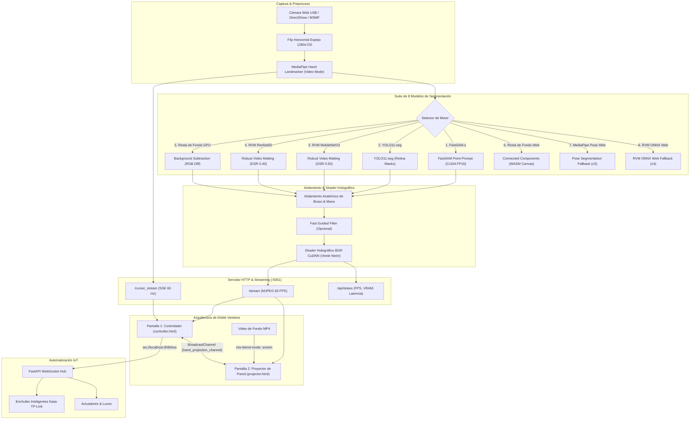

# 🏛️ Arquitectura del Sistema: Unified Vision Engine & Projection Mapping

El sistema **Touchless Projection Mapping** integra visión artificial acelerada por hardware (CUDA), modelos fundacionales neuronales, algoritmos diferenciales, interfaz de doble pantalla en tiempo real y automatización física por WebSockets.

---

## 📐 Diagrama de Flujo del Sistema

---

## 🎯 Modelos de Segmentación Disponibles

| ID | Modelo | Dispositivo | Latencia | FPS | Caso de Uso Óptimo |
| :--- | :--- | :---: | :---: | :---: | :--- |
| **fastsam** | **FastSAM-s Point-Prompt** | CUDA | ~30 ms | **33 FPS** | **Recomendado por defecto.** Cero parpadeo, contornos orgánicos finos sin bounding boxes. |
| **yolo** | **YOLO11-seg** | CUDA | ~27 ms | **37 FPS** | Máxima velocidad pura con `retina_masks=True` y filtrado por instancia. |
| **rvm_mobilenet** | **RVM MobileNetV3** | CUDA | ~29 ms | **34 FPS** | Video matting temporal recurrente con memoria profunda de bordes. |
| **rvm_resnet** | **RVM ResNet50** | CUDA | ~35 ms | **28 FPS** | Máxima calidad y resolución en siluetas y dedos. |
| **background_subtraction** | **Resta de Fondo GPU** | GPU / CPU | ~29 ms | **34 FPS** | Resta diferencial contra pared física calibrada con tecla `[Espacio]`. |
| **web_bg_sub** | **Resta de Fondo Web** | Navegador | ~25 ms | **40 FPS** | Fallback 100% en navegador con semillas anatómicas de MediaPipe. |
| **web_pose** | **MediaPipe Pose** | Navegador | ~35 ms | **28 FPS** | Fallback web independiente basado en pose anatómica (v3). |
| **web_rvm** | **RVM ONNX Web** | Navegador | ~45 ms | **22 FPS** | Fallback web basado en ONNX Runtime WebAssembly (v4). |

---

## 🖥️ Arquitectura de Doble Ventana (Dual-Screen)

### 1. Ventana del Operador (`controller.html` / `index.html`)
- Ubicada en la pantalla de la laptop.
- Muestra la vista en vivo de la cámara con polígonos interactivos de `objects.json`.
- Selector dinámico de los 8 modelos neuronales y matemáticos.
- Telemetría en tiempo real: FPS, Latencia (ms), VRAM (MB), CPU (%).
- Controles de video de fondo: Carga de archivos locales `.mp4`/`.webm`, botón de play/pause, y deslizador de brillo (10% - 100%).
- Conexión WebSocket a Docker en `ws://localhost:8080/ws` para despachar clics físicos sobre dispositivos.

### 2. Ventana de Proyección en Pared (`projector.html` / `projection.html`)
- Ubicada en la pantalla extendida (HDMI al proyector).
- Presionar **F11** o **F** para pantalla completa.
- **Fondo negro absoluto (#000000):** Cero emisión de luz en zonas sin interacción.
- **Cero UI:** Sin texto, sin menús, sin punteros visibles en la pared.
- **Fusión Óptica Aditiva:** Utiliza `mix-blend-mode: screen` para proyectar el brazo holográfico verde neón sobre cualquier video de fondo sin tapar la escena.
- **Reconexión Automática:** Watchdog integrado con auto-recuperación si el servidor se reinicia.
